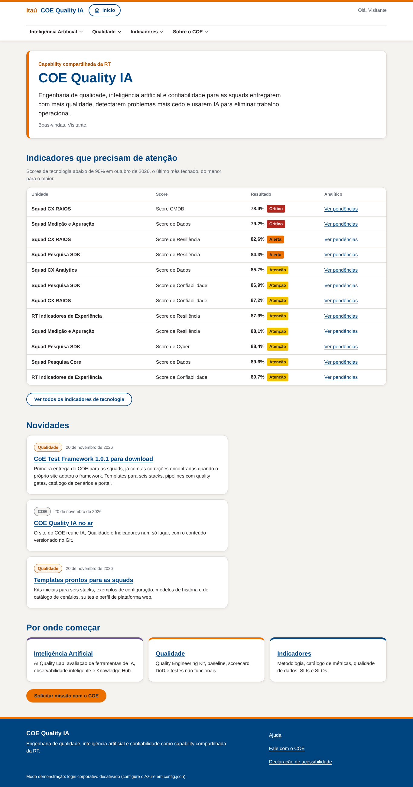

# COE Quality IA

Site interno de consulta do COE Quality + IA: Inteligência Artificial, Qualidade e Indicadores para as squads da RT, com o conteúdo versionado no Git.

- **Angular 18**, componentes standalone.
- **Design system:** camada de tokens com nomes no padrão IDS (Itaú Design System), em `src/styles/tokens.css`. Os valores são provisórios até a adoção do pacote oficial do IDS v3 (Magma).
- **Acessibilidade:** WCAG 2.2 nível AA, com axe e testes de teclado em todas as páginas a cada PR.
- **Login:** SSO corporativo via Azure (Microsoft Entra ID, MSAL). O site é só de consulta e não tem papéis.
- **Conteúdo:** Markdown versionado no Git. Mudanças entram por pull request.



## Rodar localmente
```bash
npm ci
npm start                 # gera o índice de conteúdo e abre em http://localhost:4200
npm run build             # índice + verificação de tokens + build de produção
npm run e2e               # Playwright + axe contra o build (54 testes)
```
Sem `azure.clientId` em `public/config.json`, o site roda em **modo demonstração**, sem login.

## Estrutura
| Caminho | O que é |
| --- | --- |
| `src/styles/tokens.css` | Tokens provisórios no padrão IDS: cores, tipografia, espaçamento, raio, foco |
| `src/app/navegacao.ts` | Menus do topo (Inteligência Artificial, Qualidade, Indicadores, Sobre o COE) e subpáginas |
| `src/app/layout/` | Cabeçalho (logo, botão Início, menus expansíveis) e rodapé |
| `src/app/paginas/` | Início (indicadores que precisam de atenção, novidades e atalhos), visão geral de área, página de conteúdo, indicadores de tecnologia, Skills, MCPs e Fale com o COE |
| `public/conteudo/paginas/` | Texto das subpáginas, em Markdown |
| `public/conteudo/novidades/` | Novidades da página inicial |
| `public/dados/` | Dados das páginas por componente: `indicadores-tecnologia.json` (último score mensal, faixas e links dos dashboards), `skills.json` e `mcps.json` (catálogos). Mudanças por pull request |
| `public/downloads/` | Pacotes para download, com a versão no nome (ex.: `coe-test-framework-v1.0.0.zip`) |
| `public/config.json` | Configuração em tempo de execução: Azure, repositório, contato |
| `public/marca/` | Arquivo oficial do logo do Itaú (veja `docs/marca.md`) |
| `scripts/` | Geração do índice de conteúdo e verificação de tokens |
| `e2e/` | Testes Playwright + axe |

## Alterar o conteúdo
1. Edite o Markdown em `public/conteudo/paginas/<área>/` (páginas) ou em `public/conteudo/novidades/` (novidades da página inicial), ou os dados em `public/dados/`.
2. Abra o pull request. O CI valida os metadados, gera o índice e roda os testes de acessibilidade.
3. Os revisores definidos em `.github/CODEOWNERS` aprovam.

## Configurar o login (Azure)
Em `public/config.json`:
```json
{ "azure": { "clientId": "<id do app registrado>", "tenantId": "<tenant do Itaú>", "redirectUri": "https://<endereço do site>" } }
```
Registre o app no Entra ID como *Single-page application*, com o mesmo redirect URI.

## Trocar pelo IDS v3 oficial
1. Instale o pacote de tokens, fontes e ícones do IDS v3.
2. Substitua os valores de `src/styles/tokens.css` pelos tokens oficiais, ou reaponte as variáveis `--ids-*`.
3. Troque o `IconeComponent` pelos ícones oficiais e os componentes básicos (botão, cartão, tag, tabela) pelos do IDS.
4. Rode `npm run build && npm run e2e`. O axe revalida a acessibilidade.

`npm run tokens` impede cor ou fonte escrita à mão fora do arquivo de tokens.
